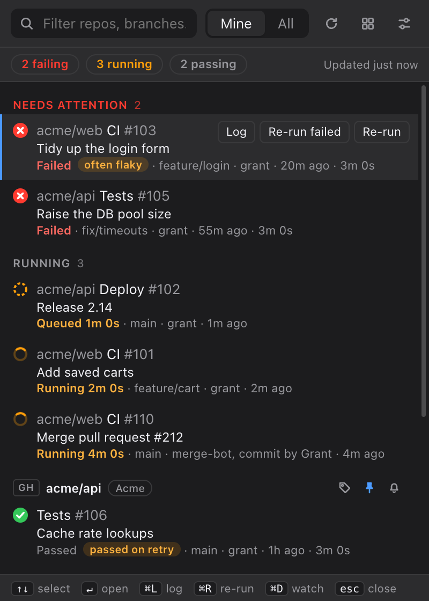
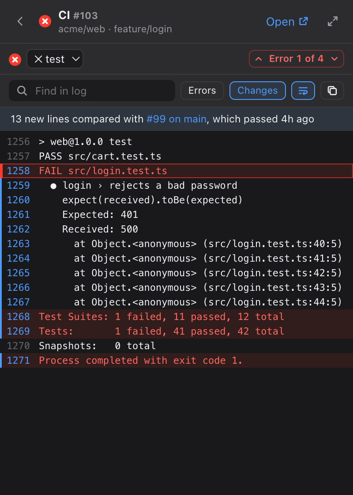

# Pipescope

A macOS menu bar app for GitHub Actions and Bitbucket Pipelines. It watches every repo you can access and tells you when your runs fail. You can re-run, cancel or read the log without opening a browser.

  
  

## Install

Download the `.dmg` from the [latest release](https://github.com/madebygrant/pipescope/releases/latest) and drag Pipescope to Applications. The build isn't signed yet, so right-click it and choose Open the first time. Or [build it from source](docs/development.md#install-from-source) with one command, which avoids that warning.

Then connect GitHub, Bitbucket or both. GitHub uses your `gh` CLI login if you have one. Bitbucket needs your Atlassian email and an API token, with the scopes listed in [Setup](docs/setup.md). `⌥⌘P` opens Pipescope from anywhere.

## What it does

- Lists what's failing first, then what's running, then each repo's recent runs. Every run has buttons for its main action and its log, and right-clicking a run shows the rest.
- Shows how far along each running run is, estimated from how long that workflow's recent passes took.
- Opens a failing log at the first error, counts the lines that weren't in the last passing run, and pulls out the expected and received values from Jest and Vitest failures.
- Spots flaky workflows that passed on a retry of the same commit, and can re-run them once for you.
- Notifies you when your runs fail or recover, with optional branch filters and quiet hours. Watch any run to hear when it finishes.
- Approves or rejects GitHub deployments waiting on you.
- Groups repos by client and totals each client's build time per month.
- Ignores repos matching patterns like `acme/legacy-*`, so they're never fetched.
- Comes in light and dark, following macOS or set by hand.

## Docs

- [Setup](docs/setup.md): accounts, tokens, launch at login and where data is kept
- [Using Pipescope](docs/usage.md): the list, logs, notifications and keyboard shortcuts
- [How it works](docs/how-it-works.md): polling, rate limits and what each provider can do
- [Development](docs/development.md): building from source, tests, CI and releases
